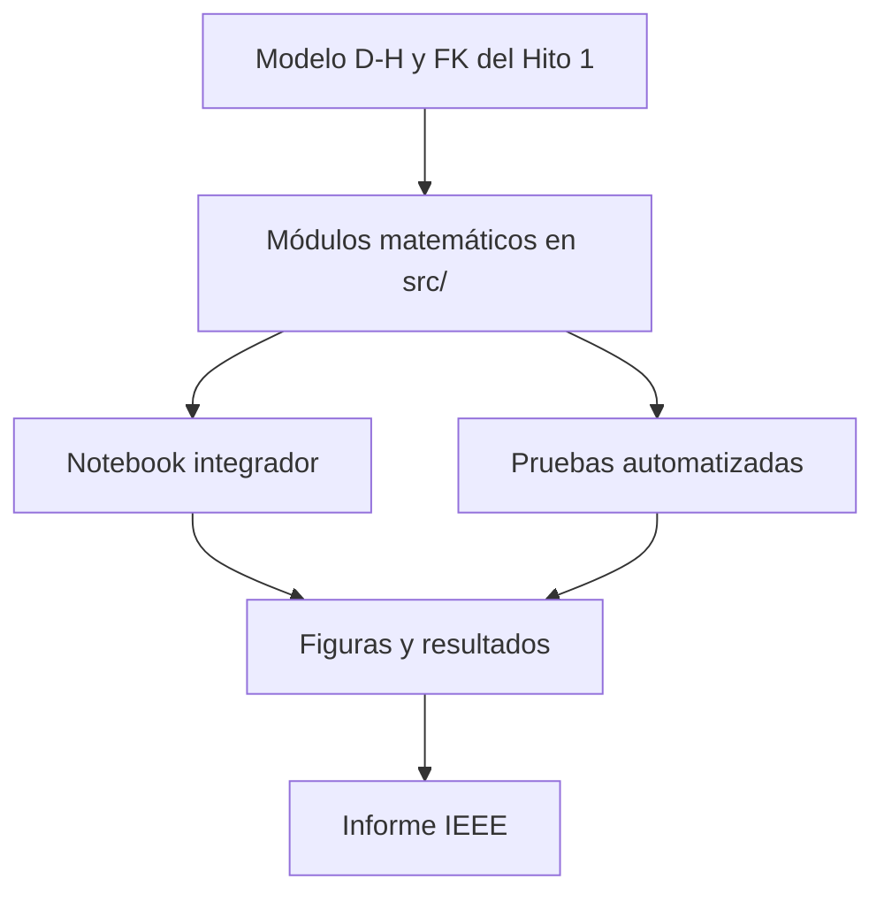
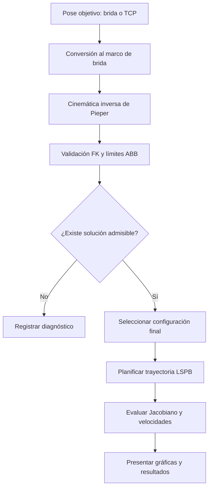
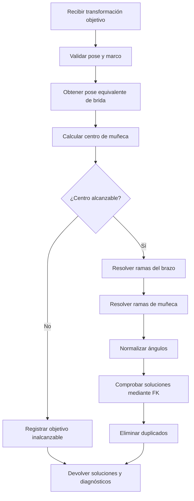
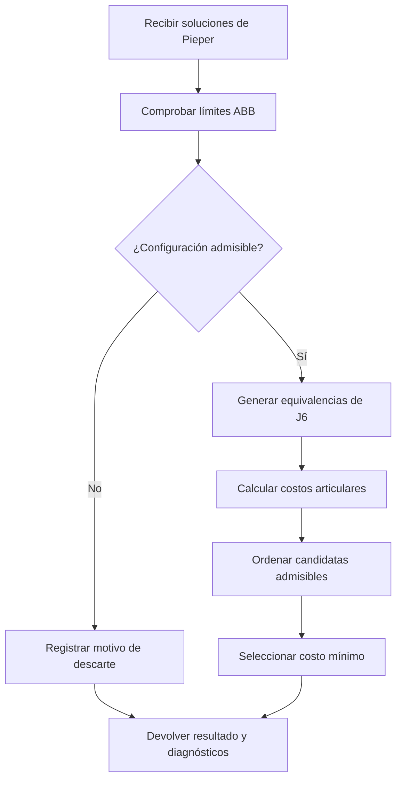
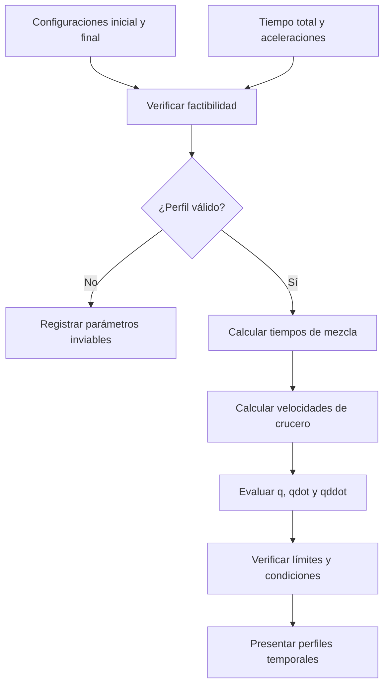
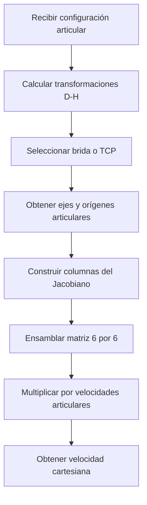
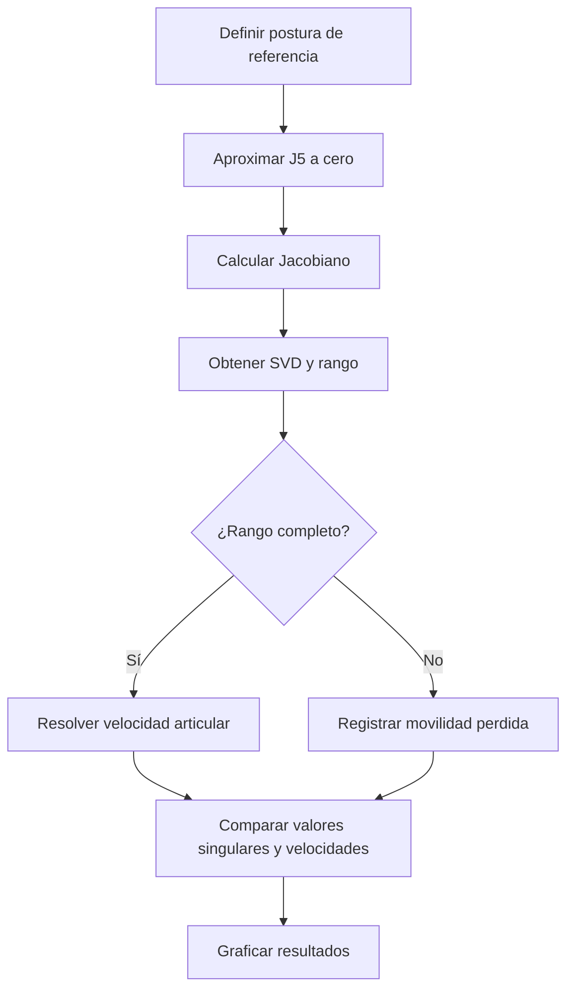
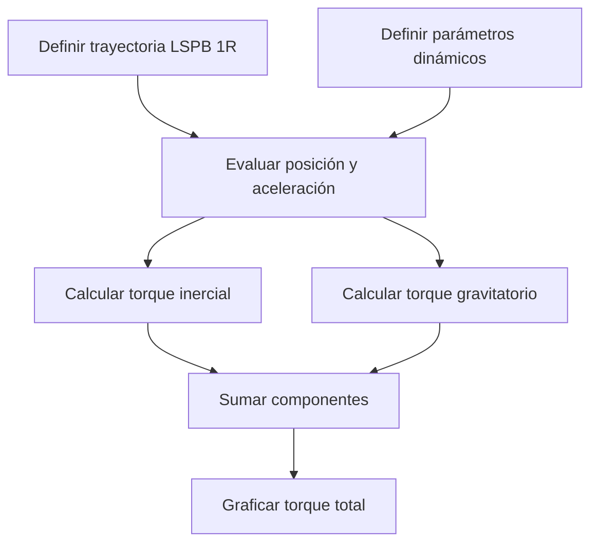

# Diagramas de flujo — Hito 2

## 1. Arquitectura general

El Hito 2 utiliza el modelo cinemático validado en el Hito 1 y desarrolla módulos independientes para cinemática inversa, planificación y análisis.

La implementación matemática reside en `src/`. El Notebook contiene los ensayos y resultados de integración.

## 2. Flujo funcional del Hito 2

El análisis independiente de singularidades y el modelo académico de dinámica 1R complementan la evaluación principal.

## 3. Cinemática inversa analítica de Pieper

La función `solve_pieper()` resuelve las configuraciones articulares compatibles con una pose objetivo válida.

### Desacoplamiento geométrico

El centro de muñeca se determina mediante:

$$
\mathbf p_{wc}=
\mathbf p_d-d_6R_d
\begin{bmatrix}0\\0\\1\end{bmatrix}
$$

La orientación residual se obtiene como:

$$
R_3^6=(R_0^3)^TR_d
$$

En posturas regulares pueden existir hasta ocho ramas matemáticas. Las singularidades pueden producir ramas coincidentes o familias continuas de soluciones.

**Implementación:** `src/pieper.py`.

## 4. Filtrado ABB y selección articular

### Criterio de selección

Entre las representaciones articulares admisibles se utiliza:

$$
C(\mathbf q)=
\sum_{i=1}^{6}
w_i(q_i-q_{\mathrm{inicio},i})^2
$$

La solución seleccionada es aquella que minimiza el costo.

Los pesos son configurables; por defecto, cada articulación tiene peso unitario.

### Tratamiento de J6

El módulo considera representaciones equivalentes:

$$
q_6'=q_6+2k\pi,\qquad k\in\mathbb Z
$$

Las representaciones se conservan únicamente cuando cumplen el rango nominal ABB de −400° a +400°.

Aunque producen la misma pose mediante FK, pueden requerir desplazamientos articulares diferentes desde `q_inicio`.

### Información conservada

El resultado incluye:

- Configuraciones admisibles y sus costos.
- Ramas descartadas y sus violaciones de límites.
- Configuración seleccionada, si existe.
- Diagnósticos de Pieper y del filtrado.

**Implementaciones:** `src/limites_irb120.py` y `src/seleccion_pieper.py`.

## 5. Planificación articular LSPB

Para cada articulación:

$$
\Delta q_i=q_{f,i}-q_{0,i}
$$

La condición de factibilidad es:

$$
a_i\geq\frac{4|\Delta q_i|}{t_f^2}
$$

El tiempo de mezcla satisface:

$$
|\Delta q_i|=
a_i t_{c,i}(t_f-t_{c,i})
$$

La velocidad de crucero es:

$$
v_{c,i}=
\operatorname{sgn}(\Delta q_i)a_i t_{c,i}
$$

### Evaluación por fases

1. Aceleración.
2. Velocidad constante, cuando existe.
3. Frenado hasta el reposo.

El LSPB ideal mantiene continuidad de posición y velocidad. La aceleración puede cambiar de manera discontinua.

En la planificación 6R se utiliza una duración común para las seis articulaciones.

**Implementación:** `src/lspb.py`.

## 6. Jacobiano geométrico

### Convenciones

El Jacobiano expresa sus componentes respecto al marco base `{0}`:

$$
{}^0\mathbf V_e=
{}^0J_e(\mathbf q)\dot{\mathbf q}
$$

Para una articulación revoluta:

$$
{}^0J_i=
\begin{bmatrix}
{}^0\mathbf z_{i-1}\times
({}^0\mathbf p_e-{}^0\mathbf o_{i-1})\\
{}^0\mathbf z_{i-1}
\end{bmatrix}
$$

El Jacobiano tiene dimensión 6×6:

- Tres filas de velocidad lineal.
- Tres filas de velocidad angular.
- Una columna por articulación.

### Validación

Se verificó mediante:

- Cálculo manual de columnas de J1 y J2.
- Comparación de transformaciones con FK.
- Diferencias finitas de posición y orientación.
- Comprobaciones para brida y TCP.

**Implementación:** `src/jacobiano.py`.

## 7. Experimento de singularidad de muñeca

### Criterio de singularidad

$$
\operatorname{rank}(J)<6
$$

En la configuración analizada, cuando $q_5=0$, los ejes de J4 y J6 se alinean y el rango del Jacobiano disminuye de 6 a 5.

El experimento registra:

- Rango del Jacobiano.
- Menor valor singular.
- Número de condición.
- Norma de velocidad articular requerida.

Para una misma consigna cartesiana, la norma de velocidad articular puede crecer considerablemente al aproximarse a la singularidad.

En la postura singular no se invierte el Jacobiano.

**Implementación:** `src/singularidades.py`.

## 8. Dinámica reducida 1R

### Modelo matemático

$$
\tau(t)=J_{1R}\ddot q(t)+mg\ell_c\sin q(t)
$$

Torque inercial:

$$
\tau_I(t)=J_{1R}\ddot q(t)
$$

Torque gravitatorio:

$$
\tau_g(t)=mg\ell_c\sin q(t)
$$

### Caso de validación

Se utiliza el ejemplo oficial W10-S01:

| Parámetro | Valor |
|---|---:|
| Inercia equivalente | 0.25 kg·m² |
| Masa | 1 kg |
| Distancia al centro de masa | 0.5 m |
| Gravedad | 9.81 m/s² |
| Desplazamiento | 0 a 2 rad |
| Tiempo total | 3 s |
| Aceleración | 1 rad/s² |

Para $t=2.5$ s se obtuvo:

$$
\tau=4.429791\ \mathrm{N\,m}
$$

El modelo corresponde a una articulación académica y no representa los torques reales del ABB IRB 120 completo.

**Implementación:** `src/dinamica_1r.py`.

## 9. Validación del sistema

Los componentes se verificaron mediante pruebas automatizadas e integración en Jupyter.

Las validaciones comprenden:

- Cinemática directa.
- Soluciones analíticas de Pieper.
- Límites ABB y selección.
- Factibilidad LSPB.
- Jacobiano geométrico.
- Singularidad de muñeca.
- Dinámica reducida 1R.

En la ejecución integral del 22 de octubre de 2026 se obtuvieron **71 pruebas satisfactorias**.

Los resultados se presentan en `notebooks/hito2_integracion.ipynb` y en el informe IEEE.

## 10. Referencias

### Material académico

- `S09_material_oficial.pdf`: guías de implementación del Hito 2.
- `S10_material_oficial.pdf`: guía, rúbrica y solucionario.
- `Guia_PFI.pdf`: alcance general del proyecto.

### Documentación técnica

- ABB `3HAC035960-005`.
- ABB `3HAC035728-005`.
- `docs/arquitectura_y_convenciones.md`.
- `docs/requisitos_y_fuentes.md`.
