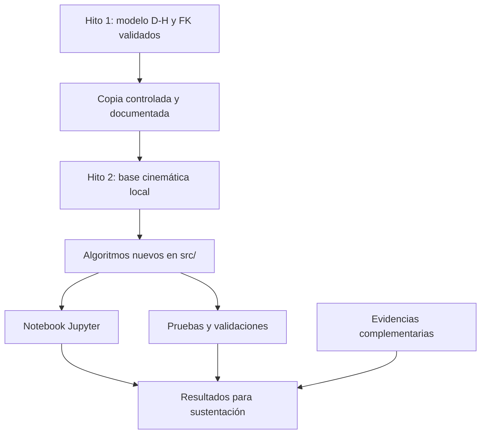
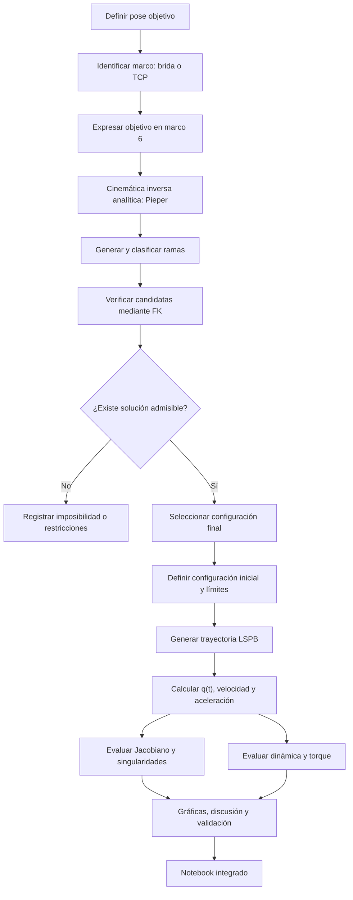
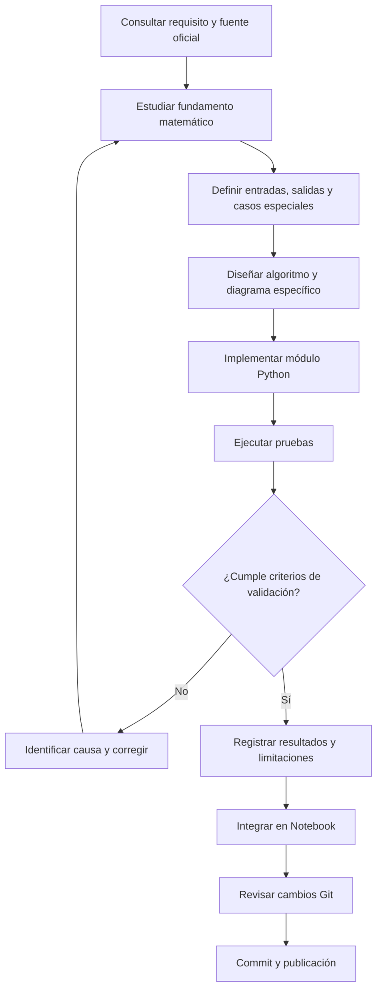

# Diagramas de flujo — Hito 2 ABB IRB 120

Este documento representa la arquitectura funcional y los procesos generales de desarrollo y validación del Hito 2.

Los diagramas describen el diseño previsto. No representan implementaciones terminadas ni resultados ya validados.

Los diagramas específicos de cada algoritmo se incorporarán conforme avance su desarrollo matemático y computacional.

## 1. Arquitectura general del Hito 2

La cinemática directa se incorporará desde el Hito 1 mediante copia controlada, conservando la procedencia del código y sus convenciones geométricas.

El Hito 2 se ejecutará utilizando sus propios archivos, sin depender de la carpeta del Hito 1.

Los algoritmos se organizarán en módulos Python y se presentarán mediante un Notebook integrado.

## 2. Flujo funcional del Hito 2

La transformación de la pose objetivo se realizará cuando sea necesario distinguir el TCP del marco terminal D-H.

Las soluciones de Pieper se verificarán mediante la cinemática directa. No se supondrá que toda pose produce ocho soluciones físicas distintas y admisibles.

El análisis de singularidades también incluirá experimentos específicos cuando la trayectoria LSPB elegida no atraviese una configuración singular.

El modelo de torque deberá declarar sus parámetros físicos e hipótesis.

## 3. Flujo de desarrollo y validación de un módulo

Cada módulo se desarrollará de forma progresiva, relacionando sus fundamentos matemáticos con las funciones implementadas.

Las pruebas deben producir evidencia reproducible. Se incorporarán procedimientos manuales cuando sean exigidos o aporten valor a la sustentación.

Los commits registrarán cambios lógicos del desarrollo, evitando tanto las modificaciones masivas como la fragmentación innecesaria.

## 4. Diagramas específicos pendientes

Se añadirán posteriormente, cuando corresponda:

- Pieper: desacoplamiento, ramas analíticas, filtrado y validación FK.
- LSPB: selección de parámetros, factibilidad y evaluación temporal.
- Jacobiano: construcción geométrica y comprobación manual.
- Singularidades: evaluación de rango y experimento de proximidad.
- Dinámica: evaluación del modelo y cálculo de torques.

No se considerarán terminados estos diagramas hasta estudiar y comprobar los procedimientos correspondientes.

## 5. Referencias

**Fuentes académicas:**

- `S09_material_oficial.pdf`, guías W09-S01 y W09-S02.
- `S10_material_oficial.pdf`, seguimiento W10-S01.

**Documentación interna:**

- `requisitos_y_fuentes.md`.
- `arquitectura_y_convenciones.md`.
- Diagramas del Hito 1: `equipo/hitos/hito1/docs/diagramas_flujo.md`.

Los flujos aquí descritos corresponden al diseño técnico del equipo. Los requisitos específicos del docente se identifican en `requisitos_y_fuentes.md`.
