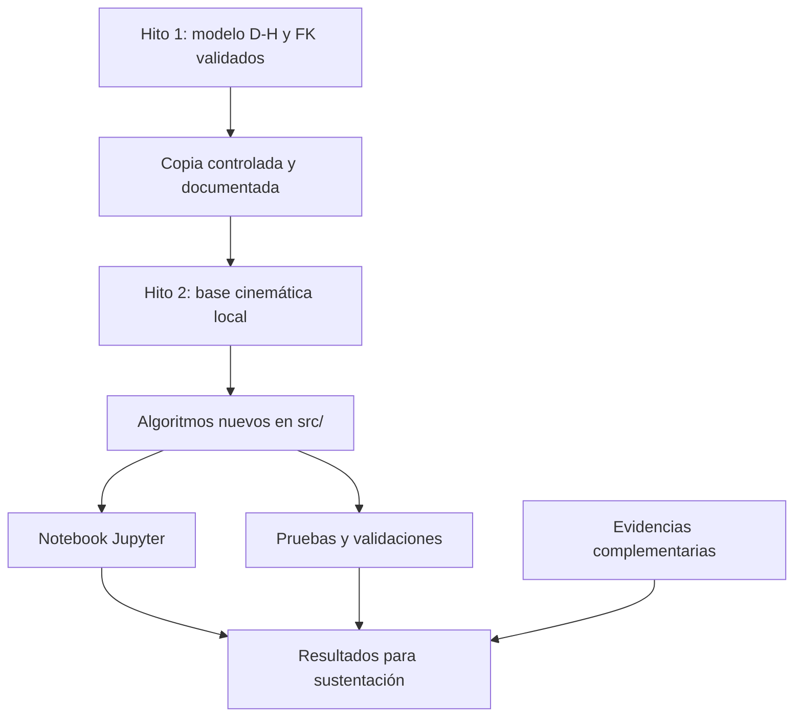
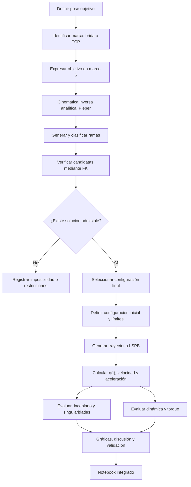
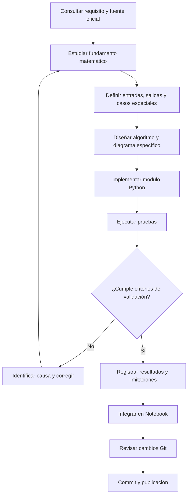
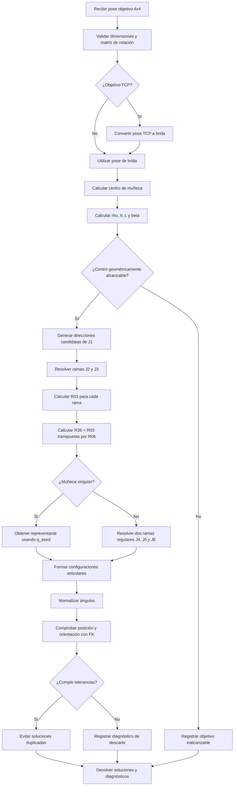
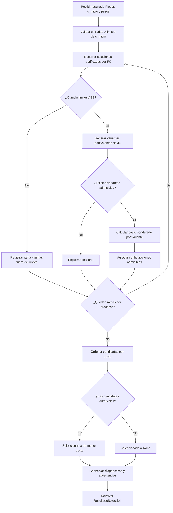

# Diagramas de flujo — Hito 2 ABB IRB 120

Este documento representa la arquitectura funcional y los procesos generales de desarrollo y validación del Hito 2.

Los diagramas describen el diseño previsto. No representan implementaciones terminadas ni resultados ya validados.

Los diagramas específicos de cada algoritmo se incorporarán conforme avance su desarrollo matemático y computacional.

## 1. Arquitectura general del Hito 2



La cinemática directa se incorporará desde el Hito 1 mediante copia controlada, conservando la procedencia del código y sus convenciones geométricas.

El Hito 2 se ejecutará utilizando sus propios archivos, sin depender de la carpeta del Hito 1.

Los algoritmos se organizarán en módulos Python y se presentarán mediante un Notebook integrado.

## 2. Flujo funcional del Hito 2



La transformación de la pose objetivo se realizará cuando sea necesario distinguir el TCP del marco terminal D-H.

Las soluciones de Pieper se verificarán mediante la cinemática directa. No se supondrá que toda pose produce ocho soluciones físicas distintas y admisibles.

El análisis de singularidades también incluirá experimentos específicos cuando la trayectoria LSPB elegida no atraviese una configuración singular.

El modelo de torque deberá declarar sus parámetros físicos e hipótesis.

## 3. Flujo de desarrollo y validación de un módulo



Cada módulo se desarrollará de forma progresiva, relacionando sus fundamentos matemáticos con las funciones implementadas.

Las pruebas deben producir evidencia reproducible. Se incorporarán procedimientos manuales cuando sean exigidos o aporten valor a la sustentación.

Los commits registrarán cambios lógicos del desarrollo, evitando tanto las modificaciones masivas como la fragmentación innecesaria.

## 4. Diagramas específicos pendientes

Se añadirán posteriormente, cuando corresponda:

- Pieper: desacoplamiento, ramas analíticas, filtrado y validación FK.
- LSPB: selección de parámetros, factibilidad y evaluación temporal.
- Jacobiano: construcción geométrica y comprobación manual.
- Singularidades: evaluación de rango y experimento de proximidad.
- Dinámica: evaluación del modelo y cálculo de torques.

No se considerarán terminados estos diagramas hasta estudiar y comprobar los procedimientos correspondientes.

## 5. Referencias

**Fuentes académicas:**

- `S09_material_oficial.pdf`, guías W09-S01 y W09-S02.
- `S10_material_oficial.pdf`, seguimiento W10-S01.

**Documentación interna:**

- `requisitos_y_fuentes.md`.
- `arquitectura_y_convenciones.md`.
- Diagramas del Hito 1: `equipo/hitos/hito1/docs/diagramas_flujo.md`.

Los flujos aquí descritos corresponden al diseño técnico del equipo. Los requisitos específicos del docente se identifican en `requisitos_y_fuentes.md`.

## 6. Diagrama específico: cinemática inversa analítica de Pieper

Este diagrama representa el procedimiento implementado en `src/pieper.py` para el ABB IRB 120, utilizando el modelo D-H incorporado desde el Hito 1.



Las operaciones sobre las ramas de brazo y muñeca se repiten para cada candidata. El diagrama resume el procedimiento; los bucles y condiciones exactos se encuentran en el código fuente.

### Interfaz implementada

La función principal es:

```python
solve_pieper(
    T_target,
    target_frame="flange",
    q_seed=None,
    position_tolerance_m=1e-8,
    orientation_tolerance_rad=1e-7,
    singularity_tolerance=1e-9,
)
```

- `T_target`: matriz homogénea objetivo de 4 × 4.
- `target_frame`: `"flange"` o `"tcp"`.
- `q_seed`: referencia articular opcional, en radianes, utilizada para elegir representantes en ciertos casos singulares. No selecciona la solución final de una lista de ramas regulares.
- `position_tolerance_m`: tolerancia de validación FK en metros.
- `orientation_tolerance_rad`: tolerancia de orientación en radianes.
- `singularity_tolerance`: umbral numérico utilizado para detectar situaciones geométricas degeneradas o singulares.

La salida `PieperResult` incluye:

- `solutions`: candidatas que superaron la comprobación FK.
- `wrist_center_m`: posición del centro de muñeca en el marco base.
- `diagnostics`: mensajes relativos a singularidades, imposibilidades geométricas y descartes.

Cada objeto `PieperSolution` registra sus seis ángulos articulares, las ramas de brazo y muñeca, los errores de reconstrucción y si representa un caso singular.

### Validación inicial realizada

El 13 de octubre de 2026 se ejecutaron desde `hito2/` las pruebas automatizadas con `unittest`.

Resultado: **11 pruebas satisfactorias**, incluyendo cuatro de FK y siete de Pieper.

La prueba de Pieper contempla una pose con ocho ramas regulares, entradas de TCP, casos singulares, entrada inválida, objetivo inalcanzable y 100 configuraciones articulares aleatorias.

El código verifica las transformaciones candidatas usando la FK local del Hito 2.

### Limitaciones actuales

El algoritmo todavía no aplica los límites articulares del fabricante ni comprueba colisiones. Tampoco selecciona automáticamente la candidata óptima para el posterior movimiento LSPB.

En singularidades devuelve un representante de la familia de soluciones y registra la situación mediante los diagnósticos correspondientes.

Por tanto, los resultados actuales constituyen soluciones matemáticas comprobadas mediante FK, no una garantía de ejecución física en el ABB IRB 120.

### Referencias

- `S09_material_oficial.pdf`, guía W09-S01: ramas analíticas y verificación por cinemática directa.
- `S09_material_oficial.pdf`, guía final W09-S02: integración de Pieper en el pipeline del Hito 2.
- `src/pieper.py`: implementación propia del Hito 2.
- `validacion/test_pieper.py`: pruebas automatizadas.
- `src/irb120_fk.py`: cinemática directa reutilizada y validada.


## 7. Diagrama específico: filtrado ABB y selección de soluciones

Este diagrama representa el módulo `src/seleccion_pieper.py`, que procesa las soluciones matemáticas obtenidas mediante `src/pieper.py`.

Los límites articulares corresponden a los rangos nominales publicados por ABB, documentados en `arquitectura_y_convenciones.md`, sección 10.



### Criterio de selección

Entre las representaciones articulares admisibles se utiliza:

\[
C(q)=\sum_{i=1}^{6}w_i(q_i-q_{inicio,i})^2
\]

La solución seleccionada es aquella que minimiza el costo.

Los pesos son configurables; por defecto cada articulación tiene peso unitario.

### Tratamiento de J6

El módulo considera representaciones equivalentes:

\[
q_6'=q_6+2k\pi
\]

con \(k\) entero y siempre dentro del rango nominal ABB de -400° a +400°.

Se conservan las representaciones admisibles para evaluar cuál requiere menor desplazamiento desde `q_inicio`.

### Información conservada

La salida `ResultadoSeleccion` mantiene:

- Configuraciones admisibles y sus costos.
- Ramas descartadas y sus violaciones de límites.
- Configuración seleccionada, si existe.
- Diagnósticos originales de Pieper y advertencias adicionales.

### Validación y limitaciones

El 13 de octubre de 2026 se ejecutaron 24 pruebas satisfactorias: cuatro de FK, siete de Pieper, seis de límites articulares y siete de selección.

El módulo no evalúa colisiones ni factibilidad temporal. Las configuraciones seleccionadas aún requieren un análisis LSPB y validación de velocidades y aceleraciones.

Las soluciones singulares corresponden a representantes particulares y no a una exploración exhaustiva de las familias continuas.

### Referencias

- `3HAC035960-005`, revisión W, sección 1.8.1, página impresa 37.
- `3HAC035728-005`, revisión W, sección 2.2.2, página impresa 50.
- `docs/arquitectura_y_convenciones.md`, secciones 10 y 11.
- `src/limites_irb120.py`.
- `src/seleccion_pieper.py`.
- `validacion/test_limites_irb120.py`.
- `validacion/test_seleccion_pieper.py`.
