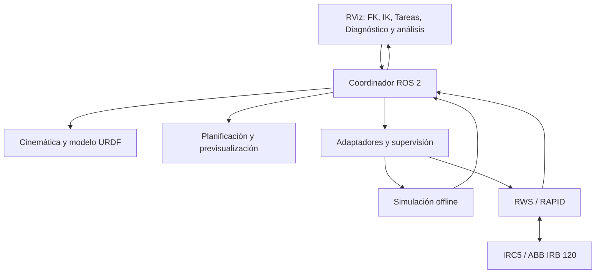

# Arquitectura del sistema

| Paquete | Responsabilidad |
| --- | --- |
| `imt342_irb120_description` | URDF y mallas visuales y de colisión |
| `imt342_irb120_kinematics` | FK, IK Pieper, Jacobiano, singularidades, dinámica 1R y geometría |
| `imt342_irb120_planning` | LSPB, quíntico, tareas y caminos |
| `imt342_irb120_control` | Adaptadores RWS, supervisión, lotes, feedback y dobles de prueba |
| `imt342_irb120_bringup` | Launch, coordinación, configuración de celda y diagnóstico |
| `imt342_irb120_rviz` | Plugins C++/Qt de operación, análisis y visualización |

## Comunicación

Normal (protocolo 1) utiliza `pcOrder` y `rbReply`; Trayectorias v2 (protocolo 2) utiliza `trjOrder` y `trjReply`. El módulo Normal se conserva en `rapid/imt342/`; v2 y sus alternativas LSPB y continua se encuentran en `experimental/trajectory_control/rws_rapid/`. Las alternativas v2 comparten nombre interno y no son tres backends independientes. EGM no forma parte de la aplicación entregada.

La observación, previsualización y autorización de ejecución son etapas distintas. Se separan las posiciones actuales, los objetivos y las referencias planificadas. La identidad del servidor, la frescura del feedback y el resultado de las órdenes intervienen en la supervisión. Una confirmación de la aplicación no sustituye el procedimiento institucional de seguridad.
